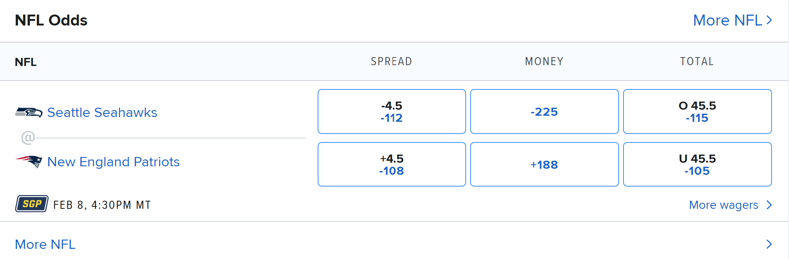

# The Mechanics of Gambling

*draft last edit 10/26/2026*
  
Sports books offer many events that can be bet on. Really anything in sports that can be quantified like an individual's scores, yards gained by an individual or team, position in an overall ranking, and of course the binary 'will this team/person win?' is something that sports books want to have people gambling on. 

When gambling on an event you are given 'odds' which describe your potential winnings if your bet pays off and you always lose your initial bet is it does not. I will focus on American odds, which are most relevant to me, and maybe delve into European, Asian, and prediction market odds if I see their relevance. 

## American Odds

Generally in American odds, negative odds or numbers indicate a favorite to win and positive odds indicate an underdog. This is advantageous for the sportsbook because the cognitive bias towards positive things pushes people to want to bet on more unlikely things which generally seem to benefit the sports book (think about how sportsbooks want all of their customers betting on highly unlikely parlays). 

When gambling in America you will see a board that is similar to here. 
 

  
Lets break down what it means so we can appropriately analyze the payouts and costs of the wagers. Look at the betting opportunities and don't worry about the 'Spread', 'Total', and 'Money' aspects but just notice that each option in this advertised matrix gives odds looking like '-110', '-10,000', and '+2,000'.

Given some binary event $A$ we will notate the event that $A$ happens as $A^+$ and $A$ does not happen as $A^-$. We can say $A$ represents a fighter winning a fight, a team losing a football game, a basketball player scoring more than 7.5 three pointers, or someone streaking at the Super Bowl. These events will be given odds where a plus notates how much a gambler profits from a \$100 bet and negative notates how much is necessary for someone to bet to win \$100 if the bet pays off. An important feature of these odds too is that they are linear, so if you have a '+200' for \$150 then a win on that bet will get you \$300. 

Simple enough, but this back and forth inversion doesn't work smoothly in the human brain and for analyzing probabilities of events so lets convert these odds to implied probabilities. Normally odds will always show the bigger number between the + and - odds. Suppose we have a bet that is -110 odds we can solve for the equivalent positive odds by considering the linearity of our bet payout.

$$110 \rightarrow 100$$

Here we can apply the linearity of these odds to get 

$$\frac{100}{110}\cdot 110 = 100 \rightarrow \frac{100}{110}\cdot 100 \approx 91$$

to have +91 equivalent odds. Here the negative odds have the bigger number so that is what is displayed in the sportsbook. 

### Converting Equivalent Odds

We can convert bidirectionally between positive and negative American odds using the scale-invariance (linearity) of bet payouts. Because American odds express payouts relative to a $100 benchmark—negative odds represent the amount risked to win $100, while positive odds represent the amount won on a $100 risk—the mapping between them is symmetric and governed by the reciprocal equation:

$$\text{Equivalent Odds} = \frac{10,000}{\text{Odds}}$$

---

#### 1. Converting Negative Odds to Positive Odds ($-X \rightarrow +Y$)

A favorite priced at $-X$ requires risking $X to win $100. To determine what this payout would equal if normalized to a standard $100 stake, scale both the risk and the payout by the factor $\frac{100}{X}$:

$$\text{Risk: } X \cdot \frac{100}{X} = \$100 \quad \longrightarrow \quad \text{Profit: } 100 \cdot \frac{100}{X} = +\frac{10,000}{X}$$

Evaluating this mapping across common favorite lines yields their direct positive return per $100 staked:

* $-200 \longrightarrow +\frac{10,000}{200} = \mathbf{+50}$ (wins $50 per $100 risked)
* $-250 \longrightarrow +\frac{10,000}{250} = \mathbf{+40}$ (wins $40 per $100 risked)
* $-333 \longrightarrow +\frac{10,000}{333} \approx \mathbf{+30}$ (wins $30 per $100 risked)
* $-500 \longrightarrow +\frac{10,000}{500} = \mathbf{+20}$ (wins $20 per $100 risked)

This formulation exposes payout proportionality directly: a $-400$ bet pays out half as much per dollar risked as a $-200$ bet ($+25$ vs. $+50$).

---

#### 2. Converting Positive Odds to Negative Odds ($+Y \rightarrow -X$)

The transformation operates identically in reverse. An underdog priced at $+Y$ wins $Y on a $100 risk. To find the equivalent stake needed to win exactly $100, scale the transaction by $\frac{100}{Y}$:

$$\text{Profit: } Y \cdot \frac{100}{Y} = \$100 \quad \longrightarrow \quad \text{Risk: } 100 \cdot \frac{100}{Y} = -\frac{10,000}{Y}$$

Applying the exact same formula maps positive underdog odds back to their negative equivalent:

* $+50 \longrightarrow -\frac{10,000}{50} = \mathbf{-200}$ (must risk $200 to win $100)
* $+40 \longrightarrow -\frac{10,000}{40} = \mathbf{-250}$ (must risk $250 to win $100)
* $+25 \longrightarrow -\frac{10,000}{25} = \mathbf{-400}$ (must risk $400 to win $100)

---

### The Bidirectional Invariant

Because the transformation is an involution ($f(f(z)) = z$):

$$\text{Positive Odds } (Y) \xrightleftharpoons[\quad Y = \frac{10,000}{X} \quad]{\quad X = \frac{10,000}{Y} \quad} \text{Negative Odds Magnitude } (X)$$

Converting odds to a single common format eliminates the cognitive friction of comparing negative numbers to positive numbers, allowing you to evaluate disparate betting lines, synthetic spreads, and pricing discrepancies on a consistent, linear scale.

### Bets as Piecewise functions

To try and describe combining wagers lets define them as a payout function dependent on the state of the world in the future. Consider a game where team A plays against team B and one team must win and the other must lose. We will describe a +Y bet of size S on team A as a bet that has cost of S and a payout function of 

$$f_{\text{team A}}^{+Y}(S)=\begin{cases} S\cdot(1 + \frac{Y}{100}) & \text{team A wins} \\ 0 & \text{team A loses} \end{cases}$$

and conversely if team A is playing against team B which has -X odds then for a bet of the size S for team B we will notate the bet as a payoff function

$$f_{\text{team B}}^{-X}(S)=\begin{cases} 0 & \text{team A wins} \\ S\cdot(1 + \frac{100}{X}) & \text{team A loses} \end{cases}$$

with the same cost S.

### Extracting Implied Probabilities

Since I have spent more time studying probabilities than gambling, I try and think about how these odds translate into implied probabilities. To get implied probabilities we need to look at the profit function which we can notate as such 

$$\Pi_{\text{team A}}^{+Y}(S) = f_{\text{team A}}^{+Y}(S) - S = \begin{cases} S\cdot(\frac{Y}{100}) & \text{team A wins} \\ -S & \text{team A loses} \end{cases}$$

Assuming a zero expectation of each sports bet (which is a generous assumption) we derive the equation for implied probabilities for an underdog +Y bet being

$$\mathbb{E}[\Pi_{\text{team A}}^{+Y}(S)] = p_{\text{team A}} \cdot \frac{S}{100}\cdot ( Y) - (1-p_{\text{team A}})\cdot S = 0$$

implying 

$$p_{\text{team A}} \cdot (\frac{S}{100}\cdot Y + S) = S$$

giving 

$$p_{\text{team A}} = \frac{100}{100 + Y}$$

Both of these formulas should be intuitive since they give us the the equation

$$p_{\text{team A}} = \frac{\text{stake}}{\text{total payout}}$$

Since we are now only thinking in terms of positive bets we can convert the implied probability of a -X bet to get implied odds of the favorite side of the bet as

$$p_{\text{team B}} = \frac{100}{100 + \frac{10,000}{X}} = \frac{X}{X + 100} = \frac{\text{stake}}{\text{total payout}}$$

### American Odds and probabilities

We would expect the sportsbooks to take a percentage of edge in these bets thus making us expect that the actual expectations of each bet to be slightly below zero in reality. Consider making a bet with American odds +Y.

Here I will notate $\pi_{\text{team A}}$ to notate the actually probability of team A winning and $p_{\text{team A}}$ as the implied odds of the bet for team A. Thus we see

$$\mathbb{E}_{reality}[\Pi_{\text{team A}}^{+Y}(S)] = \pi_{\text{team A}} \cdot \frac{S}{100}\cdot Y - (1-\pi_{\text{team A}})\cdot S < 0 = p_{\text{team A}} \cdot \frac{S}{100}\cdot Y - (1-p_{\text{team A}})\cdot S$$

and similarly

$$\mathbb{E}_{reality}[\Pi_{\text{team B}}^{-X}(S)] = \pi_{\text{team B}} \cdot \frac{100}{X}\cdot S - (1-\pi_{\text{team B}})\cdot S < 0 = p_{\text{team B}} \cdot \frac{100}{X}\cdot S - (1-p_{\text{team B}})\cdot S$$

Since the expected value of a bet is obviously monotonic with respect to the implied probability we can conclude that

$$\begin{aligned}
\pi_{\text{team A}} &< p_{\text{team A}} \\
\pi_{\text{team B}} &< p_{\text{team B}} \\
1 - \pi_{\text{team B}} = \pi_{\text{team A}} &> 1 - p_{\text{team B}}
\end{aligned}$$

letting us find the bounds for the sportsbook's actual expected probability of the event taking place as

$$1 - p_{\text{team B}} < \pi_{\text{team A}} < p_{\text{team A}}$$

Ultimately this behavior makes it so that we expect to always overpay for the likelihood of our event occuring.

## Prediction Markets

Prediction markets like Kalshi and Polymarket are making waves in the finance and gaming space after being legalized nationally. Do not be confused by the language and slightly distinct mechanics, this is also gambling. 

### How Prediction Markets Work (and why this is relevant)

When looking at my arbitrage strategy I found that the tightest markets for me to hedge my bets was on prediction markets. The way these markets work is that you are able to buy contracts for events which pay out one unit (dollar) upon the event taking place. This event can be Jerome Powell saying a specific word during FOMC, a team winning a sports bet, or China invading Taiwan by a specific date.

These markets work by allowing individuals to buy and sell these events at a specific price normally <1. These markets are lower cost to participate in, most likely because the main mechanism of these markets is not to extract edge out of its users like sportsbooks but to provide data representing public sentiment on the likelihood of an event occurring thus giving the best proxy for the likelihood of said event occuring. This works by using idea of wisdom of the crowd giving trustworthy public opinion on these events.

Given a mathematical inclination to approach these topics, it is relieving to see that prediction markets work by trading contracts of an event which resolve to a value of 1 if the event takes place and 0 if the event does not take place. The mechanics for guaranteeing fairness and trust in these evaluations of events are another interesting topic more related to crypto, so I will likely save that for another technical blog post.

Of course, if the event is certain to occur or not then there is no reason to trade, but the role of prediction markets is trade on events that are uncertain to occur with some probability, like the outcome of a sports match.

This functions by creating a free market, similar in structure to financial markets of assets, where people are allowed to trade contracts of events which pay out \$1 if the event occurs or worthless if the event does not. Here is the payout structure for a single contract for an event A taking place.

$$g(contract_A) = \begin{cases} 1 & \text{event }A \\ 0 & \text{event }A^c \end{cases}$$

This may be trivial given the description, but this also gives us an intuition for how the market belief of the likelihood of the event taking place since we can see that buying and selling will intuitively reach an equilibrium when the market does not believe the current price is worth buying above the price or selling below the current price then the expected payoff of a contract is its implied probability, and the expected profit is zero at that price, giving

$$\mathbb{E}[contract_A] = (1)\cdot p_A + (0)\cdot (1 - p_A) = p_A$$

so if the contract trades at $p_A$, the expected profit is $p_A - p_A = 0$.

### Describing bets for prediction markets

As a finance student, I have developed the intuition to fight against variance of any given financial position. To minimize variance, the strategy I will use prediction markets to hedge all bets that I make in sports books with contrary positions in prediction markets. 

We can model a position in a prediction market for the outcome A with C contracts as the function below

$$g_{A}(C) = \begin{cases} C & \text{if }A \\ 0 & \text{if }A^c \end{cases}$$

having a cost of $p_{+}\cdot C$ and for the same size with C contracts we have a payout function 

$$g_{A^c}(C) = \begin{cases} 0 & \text{if }A \\ C & \text{if }A^c \end{cases}$$

at a cost of $p_{-}\cdot C$. Notice that to prevent arbitrage 

$$p_+ + p_- \geq 1$$

Because of technically advanced market makers like SIG taking a role in these prediction markets, we can generally assume there to be no arbitrage opportunities across markets since HFT/quant firms generally act to enforce market efficiency. Because of this, you can generally expect to buy covering sets of the future at at least a dollar and sell covering sets of the future at at most a dollar because these markets typically have some non-zero spread in them.
